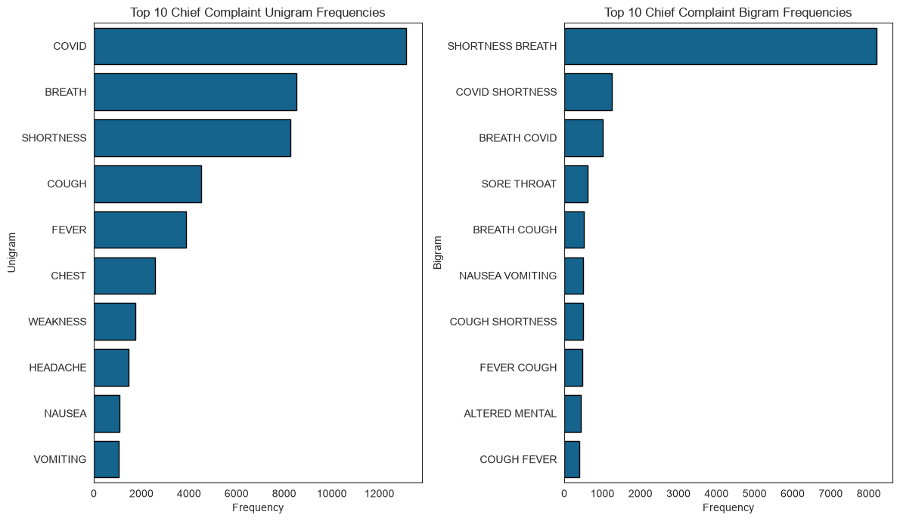
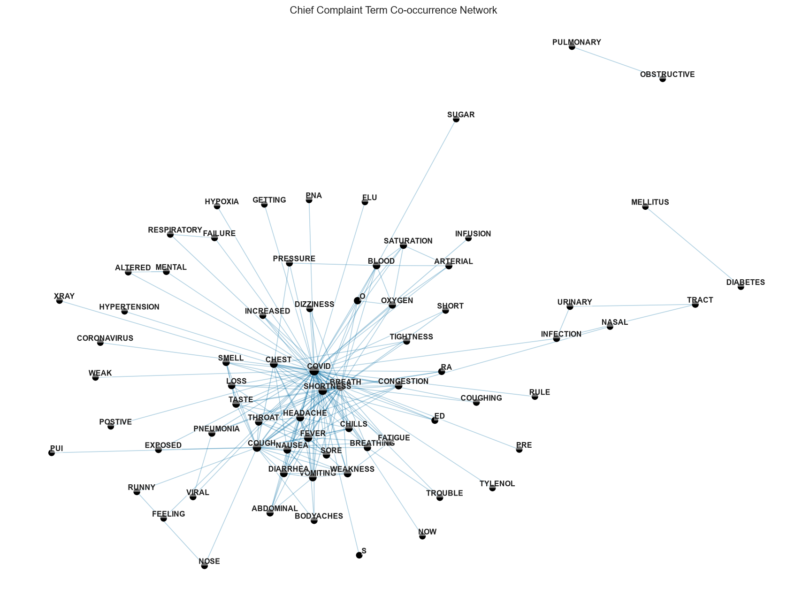
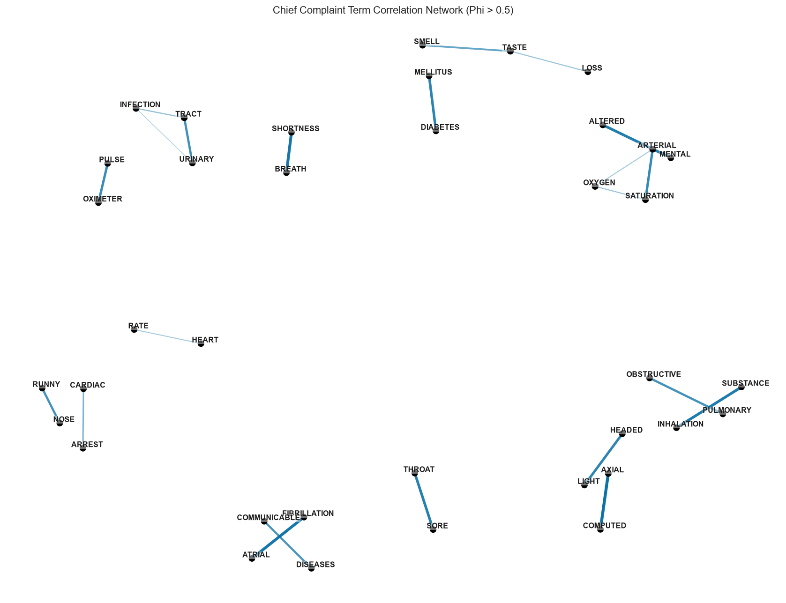

# Text Mining Example

## Introduction

In this tutorial, we describe how to perform basic text mining using line-level data from NSSP-ESSENCE. This example uses line-level data details from the Chief Complaint Query Validation (CCQV) data source for the CDC Coronavirus-DD definition, limited to ED visits (Has been Emergency = "Yes").

The CCQV data source includes the chief complaint and discharge diagnosis fields, and does not include facility location, patient location, or other demographic information. This data source was created with the NSSP Community of Practice (CoP) so that users can test and create new syndrome categories using a large corpus of chief complaint and diagnosis code data that includes more variation than would be present in any one site. Some sites have opted out of contributing their data to the Query Validation data source, including Arizona, Idaho, Illinois, Marion County, Indiana, Massachusetts, North Dakota, and Ohio.

We start this tutorial by loading the `pynssp` package.

```python
>>> from pynssp import create_profile, get_essence_data, load_nssp_stopwords
```

Then, we load additional packages for data processing and visualization purposes:

```python
>>> import re
>>> from collections import Counter
>>> from itertools import combinations
>>> from pathlib import Path
>>> import numpy as np
>>> import pandas as pd
>>> import seaborn as sns
>>> import matplotlib.pyplot as plt
>>> import networkx as nx
```

Next, we create an NSSP user profile.

```python
>>> # Creating an ESSENCE user profile
>>> myProfile = create_profile()
>>>
>>> # save profile object to file for future use
>>> # myProfile.pickle()
>>>
>>> # Load profile object
>>> # myProfile = pd.read_pickle("myProfile.pkl")
```

The above code needs to be executed only once. Upon execution, it prompts the user to provide their username and password.

Alternatively, the `myProfile` object can be saved as a `.pkl` (`.pickle`) file and loaded for future use.

## Data Pull from NSSP-ESSENCE

We now use the `myProfile` object to authenticate to NSSP-ESSENCE and pull the data.

```python
>>> url = "https://essence2.syndromicsurveillance.org/nssp_essence/api/dataDetails/csv?endDate=31Dec2020&ccddCategory=cdc%20coronavirus-dd%20v1&timeResolution=weekly&hasBeenE=1&percentParam=noPercent&userId=2362&datasource=va_erccdd&aqtTarget=DataDetails&detector=nodetectordetector&startDate=30Dec2020"
>>>
>>> api_data = get_essence_data(url, profile=myProfile)

```

We perform a standard series of text cleansing and pre-processing operations to remove meaningless patterns and common stop words, standardize free text, and return a clean version of the original dataframe that is well suited for summarizing a large corpus.

```python
>>> stopwords_pattern = r"(?i)\b(?:OF|OR|WITH|FOR|ON|LEFT|RIGHT|PT|UNSPECIFIED|STATUS|IN|HX|DAYS|AGO|UNKNOWN|TNOTE|2015|2016|2017|2018|END|NON|SMALL|CAUSES|OLD|BY|FROM|LARGE|POSSIBLE|CAUSE|ASSOCIATED|FOLLOWING|NOT|PROBLEMS|GENERAL|PROBABLY|SPECIFIED|HIGH|FURTHER|AT|WITHOUT|OTHER|OTHERWISE|STATE|USE|AS|NO|VIA|BACK|AFTER|LIKE|ALL|NEW|BUT|BE|TO|THIS|THAT|NA|IS|HAS|THE|HAVING|2019|2020)\b"
>>>
>>> pattern1 = r"\b(?:[A-Z][0-9]{2}[A-Z0-9]?(?:\.[0-9A-Z]{1,4})?|PG[0-9]{1,3})\b"
>>> pattern2 = r"[\x00-\x1F]|<BR>|[#?!?.'+)(:=@%]"
>>> pattern3 = r"\b(?:\d{1,2}|NA)\b|\|"
>>> pattern4 = r"[;/,\\*\-]|(?<=\w)/(?=\w)"
>>> pattern5 = r"\b[A-Za-z]\b"
>>>
>>> def uniq_words(text: str) -> str:
...     words = [w for w in str(text).split() if w]
...     return " ".join(dict.fromkeys(words))
...
>>> for col in ["ChiefComplaintParsed", "DischargeDiagnosis"]:
...     if col not in data.columns:
...         data[col] = ""
...
>>> data["chief_complaint_parsed"] = (
...     data["ChiefComplaintParsed"].fillna("").astype(str)
...     .str.replace(stopwords_pattern, " ", regex=True)
...     .str.replace(pattern1, " ", regex=True)
...     .str.replace(r"CHIEF COMPLAINT|SEE CHIEF", " ", regex=True)
...     .str.replace(pattern2, " ", regex=True)
...     .str.replace(pattern3, " ", regex=True)
...     .str.replace(pattern4, " ", regex=True)
...     .str.replace(r"\\s+", " ", regex=True)
...     .str.strip()
... )
>>> data.loc[data["chief_complaint_parsed"].str.len() <= 3, "chief_complaint_parsed"] = ""
>>>
>>> data["discharge_diagnosis"] = (
...     data["DischargeDiagnosis"].fillna("").astype(str)
...     .str.replace(pattern2, " ", regex=True)
...     .str.replace(pattern3, " ", regex=True)
...     .str.replace(pattern4, " ", regex=True)
...     .str.replace(r"\\s+", " ", regex=True)
...     .str.strip()
...     .str.replace(pattern5, " ", regex=True)
...     .str.replace(r"\\s+", " ", regex=True)
...     .str.strip()
... )
>>> data.loc[data["discharge_diagnosis"].str.len() <= 2, "discharge_diagnosis"] = ""
>>>
>>> data["ccdd2"] = (data["chief_complaint_parsed"] + " " + data["discharge_diagnosis"]).str.replace(r"\\s+", " ", regex=True).str.strip()
>>> data["chief_complaint_parsed"] = data["chief_complaint_parsed"].map(uniq_words)
>>> data["discharge_diagnosis"] = data["discharge_diagnosis"].map(uniq_words)
>>> data["ccdd2"] = data["ccdd2"].map(uniq_words)
>>> data["linenumber"] = np.arange(1, len(data) + 1)
>>>
>>> data[["chief_complaint_parsed", "discharge_diagnosis", "ccdd2", "linenumber"]]
>>>
>>> # Preview the `data` dataframe
>>> # data.head()
```

## Tokenization

After cleaning and preparing free-text fields, the next step in most natural language processing tasks is tokenization.

Tokenization is the process of partitioning sentences, paragraphs, or documents into smaller units such as individual words (unigrams) or contiguous sequences of n words (n-grams). These smaller units are referred to as tokens and provide a feature-based representation of text.

We load NSSP stopwords from the `pynssp` package to exclude a curated list of stopwords provided by the Community of Practice of the National Syndromic Surveillance Program (NSSP).

```python
>>> # Load NSSP stopwords
>>> nssp_stopwords = load_nssp_stopwords()
>>>
>>> STOP_WORDS = set(nssp_stopwords["word"].astype(str).str.lower().str.strip().tolist())
>>> STOP_WORDS.update({"nan", "none"})
>>>
>>> def tokenize_words(text):
...     return re.findall(r"[A-Za-z]+", str(text).lower())
...
>>> def make_ngrams(tokens, n):
...     return [" ".join(tokens[i:i+n]) for i in range(len(tokens) - n + 1)]
...
>>> rows_uni, rows_bi, rows_tri = [], [], []
>>> for _, row in data[["linenumber", "chief_complaint_parsed"]].iterrows():
...     ln = row["linenumber"]
...     toks = [t for t in tokenize_words(row["chief_complaint_parsed"]) if t not in STOP_WORDS]
...
...     rows_uni.extend([(ln, t) for t in toks])
...     rows_bi.extend([(ln, ng) for ng in make_ngrams(toks, 2)])
...     rows_tri.extend([(ln, ng) for ng in make_ngrams(toks, 3)])
...
>>> cc_unigrams = pd.DataFrame(rows_uni, columns=["linenumber", "word"])
>>> cc_bigrams = pd.DataFrame(rows_bi, columns=["linenumber", "bigram"])
>>> cc_trigrams = pd.DataFrame(rows_tri, columns=["linenumber", "trigram"])
>>>
>>> # cc_unigrams.head(), cc_bigrams.head(), cc_trigrams.head()
```

## n-gram Frequencies

We summarize the top 10 chief complaint unigram and bigram frequencies and visualize the results in horizontal bar charts.

```python
>>> sns.set_style("white")
>>>
>>> uni_top = cc_unigrams["word"].str.upper().value_counts().head(10).sort_values(ascending=False)
>>> bi_top = cc_bigrams["bigram"].str.upper().value_counts().head(10).sort_values(ascending=False)
>>>
>>> fig, axes = plt.subplots(1, 2, figsize=(12, 7))
>>>
>>> sns.barplot(x=uni_top.values, y=uni_top.index, color="#006ba2", edgecolor="black", ax=axes[0])
>>> axes[0].set_title("Top 10 Chief Complaint Unigram Frequencies")
>>> axes[0].set_xlabel("Frequency")
>>> axes[0].set_ylabel("Unigram")
>>>
>>> sns.barplot(x=bi_top.values, y=bi_top.index, color="#006ba2", edgecolor="black", ax=axes[1])
>>> axes[1].set_title("Top 10 Chief Complaint Bigram Frequencies")
>>> axes[1].set_xlabel("Frequency")
>>> axes[1].set_ylabel("Bigram")
>>>
>>> plt.tight_layout()
>>> plt.show()
```

[](#ngram-frequency)

## Chief Complaint Term Co-occurrence and Correlation

### Chief Complaint Term Co-occurrence Network Graph

```python
>>> tokens_per_line = (
...     cc_unigrams.groupby("linenumber")["word"]
...     .apply(lambda s: sorted(set(s.tolist())))
... )
>>>
>>> pair_counter = Counter()
>>> for toks in tokens_per_line:
...     for a, b in combinations(toks, 2):
...         pair_counter[(a.upper(), b.upper())] += 1
...
>>> co_df = (
...     pd.DataFrame([(a, b, n) for (a, b), n in pair_counter.items()], columns=["item1", "item2", "n"])
...     .sort_values("n", ascending=False)
...     .head(200)
... )
>>>
>>> if co_df.empty:
...     print("No co-occurrence edges available after filtering.")
... else:
...     G = nx.from_pandas_edgelist(co_df, source="item1", target="item2", edge_attr="n")
...     pos = nx.spring_layout(G, seed=42, k=0.42)
...     edge_weights = np.array([d.get("n", 1) for _, _, d in G.edges(data=True)], dtype=float)
...     edge_alphas = (edge_weights - edge_weights.min()) / (edge_weights.max() - edge_weights.min() + 1e-9)
...     degrees = dict(G.degree())
...     node_sizes = np.array([50 + 10 * np.sqrt(degrees[n]) for n in G.nodes()], dtype=float)
...
...     plt.close("all")
...     fig, ax = plt.subplots(figsize=(13, 10), dpi=130)
...
...     for (u, v, d), a in zip(G.edges(data=True), edge_alphas):
...         nx.draw_networkx_edges(
...             G, pos, edgelist=[(u, v)],
...             alpha=0.30 + 0.65 * a,
...             width=0.9 + 2.6 * a,
...             edge_color="#006BA2",
...             ax=ax
...         )
...
...     nx.draw_networkx_nodes(G, pos, node_size=node_sizes, node_color="black", linewidths=0, ax=ax)
...
...     label_pos = {n: (xy[0] + 0.012, xy[1] + 0.012) for n, xy in pos.items()}
...     labels = {n: n for n in G.nodes()}
...     nx.draw_networkx_labels(
...         G,
...         label_pos,
...         font_size=9,
...         font_weight="semibold",
...         font_color="#1a1a1a",
...         labels=labels,
...         bbox=dict(facecolor="white", edgecolor="none", alpha=0.45, pad=0.12),
...         ax=ax,
...     )
...
...     ax.set_axis_off()
...     ax.set_title("Chief Complaint Term Co-occurrence Network")
...     fig.tight_layout()
...     plt.show()
```

[](#ngram-frequency)

## Pearson Pairwise Correlation Chief Complaint Network Graph

While co-occurrence measures how frequently two terms appear together in the same chief complaint, the Phi coefficient measures how strongly two terms are associated. The Phi coefficient between two words, $w_1$ and $w_2$, is defined as:

```{math}
\phi = \frac{n_{11}n_{00} - n_{10}n_{01}}{\sqrt{n_{1 \bullet}n_{0 \bullet}n_{\bullet 0}n_{\bullet 1}}}.
```

In this context:

* $n_{11}$ is the number of chief complaints containing both $w_1$ and $w_2$
* $n_{00}$ is the number of chief complaints **not** containing both $w_1$ and $w_2$
* $n_{01}$ is the number of chief complaints containing $w_2$ and **not** $w_1$
* $n_{10}$ is the number of chief complaints containing $w_1$ and **not** $w_2$

|                         | Contains $w_2$ | Does not contain $w_2$ | Total |
|-------------------------|----------------|-------------------------|-------|
| Contains $w_1$          | $n_{11}$       | $n_{10}$                | $n_{1 \bullet}$ |
| Does not contain $w_1$  | $n_{01}$       | $n_{00}$                | $n_{0 \bullet}$ |
| Total                   | $n_{\bullet 1}$| $n_{\bullet 0}$         | $n$ |

```python
>>> word_counts = cc_unigrams["word"].value_counts()
>>> eligible_words = set(word_counts[word_counts >= 20].index)
>>>
>>> line_sets = (
...     cc_unigrams[cc_unigrams["word"].isin(eligible_words)]
...     .groupby("linenumber")["word"]
...     .apply(lambda s: set(s.tolist()))
... )
>>>
>>> N = len(line_sets)
>>> corr_rows = []
>>>
>>> eligible = sorted(eligible_words)
>>> for i, w1 in enumerate(eligible):
...     w1_lines = line_sets[line_sets.apply(lambda s: w1 in s)].index
...     set1 = set(w1_lines)
...     for w2 in eligible[i + 1:]:
...         w2_lines = line_sets[line_sets.apply(lambda s: w2 in s)].index
...         set2 = set(w2_lines)
...
...         n11 = len(set1 & set2)
...         n10 = len(set1 - set2)
...         n01 = len(set2 - set1)
...         n00 = N - n11 - n10 - n01
...
...         denom = np.sqrt((n11 + n10) * (n01 + n00) * (n11 + n01) * (n10 + n00))
...         if denom == 0:
...             continue
...
...         phi = (n11 * n00 - n10 * n01) / denom
...         if phi > 0.5:
...             corr_rows.append((w1.upper(), w2.upper(), phi))

```

Let’s visualize the network graph:

```python
>>> corr_df = pd.DataFrame(corr_rows, columns=["item1", "item2", "correlation"])
>>>
>>> if corr_df.empty:
...     print("No correlation edges found above the threshold (phi > 0.5).")
... else:
...     G_corr = nx.from_pandas_edgelist(
...         corr_df, source="item1", target="item2", edge_attr="correlation"
...     )
...     pos = nx.spring_layout(G_corr, seed=42, k=0.42)
...
...     edge_vals = np.array(
...         [d.get("correlation", 0.0) for _, _, d in G_corr.edges(data=True)],
...         dtype=float
...     )
...     edge_alphas = (edge_vals - edge_vals.min()) / (edge_vals.max() - edge_vals.min() + 1e-9)
...
...     degrees = dict(G_corr.degree())
...     node_sizes = np.array([50 + 10 * np.sqrt(degrees[n]) for n in G_corr.nodes()], dtype=float)
...
...     plt.close("all")
...     fig, ax = plt.subplots(figsize=(13, 10), dpi=130)
...
...     for (u, v, d), a in zip(G_corr.edges(data=True), edge_alphas):
...         nx.draw_networkx_edges(
...             G_corr, pos, edgelist=[(u, v)],
...             alpha=0.30 + 0.65 * a,
...             width=0.9 + 2.6 * a,
...             edge_color="#006BA2",
...             ax=ax
...         )
...
...     nx.draw_networkx_nodes(
...         G_corr, pos, node_size=node_sizes, node_color="black", linewidths=0, ax=ax
...     )
...
...     label_pos = {n: (xy[0] + 0.012, xy[1] + 0.012) for n, xy in pos.items()}
...     labels = {n: n for n in G_corr.nodes()}
...     nx.draw_networkx_labels(
...         G_corr,
...         label_pos,
...         font_size=9,
...         font_weight="semibold",
...         font_color="#1a1a1a",
...         labels=labels,
...         bbox=dict(facecolor="white", edgecolor="none", alpha=0.45, pad=0.12),
...         ax=ax,
...     )
...
...     ax.set_axis_off()
...     ax.set_title("Chief Complaint Term Correlation Network (Phi > 0.5)")
...     fig.tight_layout()
...     plt.show()
```

[](#pearson-pairwise-correlation-network-graph)
